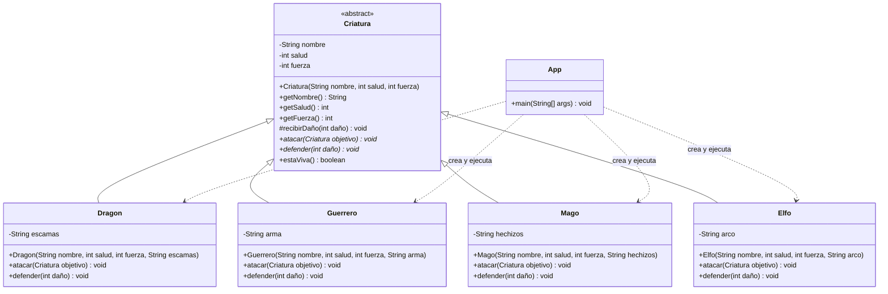

# Parcial II - Batalla de Criaturas

**Integrante:** Gian Carlos

## Parte más complicada: ataques, defensas y un poquito dde polimorfismo

La parte que más se me dificultó fue entender cómo se combinan la herencia y el polimorfismo para resolver los ataques. La clase abstracta `Criatura` define los métodos `atacar` y `defender`, pero deja que cada tipo de criatura implemente su propio comportamiento.

Cuando una criatura ataca, calcula el daño según su tipo y llama a `defender` en el objetivo. Java ejecuta la versión de `defender` correspondiente a la clase real de ese objetivo: por ejemplo, el dragón reduce el daño al 80 %, el elfo al 60 %, el guerrero al 70 % y el mago resta 5 puntos. `Math.max(1, )` asegura que el daño recibido sea como mínimo 1 tambien no sabia como trabajar bien con esa libreria .

Después, cada defensa llama a `recibirDaño`, que descuenta el daño de la salud sin permitir que baje de cero. Así cada criatura tiene una defensa distinta y la clase base centraliza la regla común para actualizar la salud.
LITOOOOOO

**Integrante** Juan david Gonzalez

## Parte complicada 
Puse el archivo de main de la estructura de la carpeta donde no iba entonces se corrigio tambien cree una rama pero fue inproductiva a la hora de realizar cambios ya que tenia un version anterior a 
a la estructura del proyecto creada 

## Diagrama de clases

